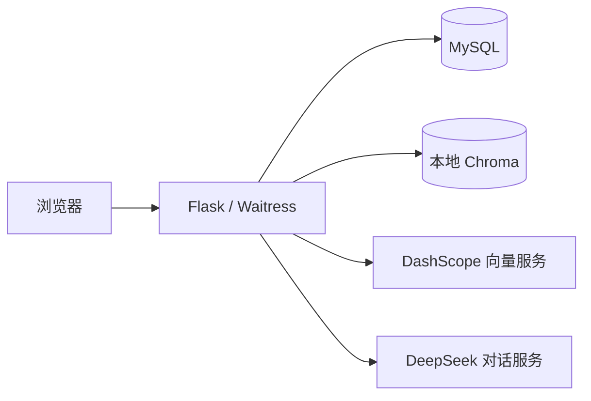

# 智慧医疗平台技术文档

版本：2.0；更新日期：2026-10-16。本文依据工程代码和实际回归测试编写，环境操作见[部署与启动](部署与启动.md)，项目概览见[README](../README.md)。

## 系统结构

系统采用 Vue 3 + Element Plus + Vue Router + Axios 前端，Flask + SQLAlchemy + MySQL 后端，Chroma 本地持久化知识库。通过 OpenAI 兼容协议调用 DashScope text-embedding-v3 和 DeepSeek deepseek-chat。

开发时 Vite 5173 代理后端 5000；Docker 将 8080 映射到应用 5000，由 Waitress 同时提供静态文件和 API。MySQL 端口不对主机发布。

## 运行环境与依赖

| 项目 | 当前配置 |
| --- | --- |
| Python / Node / MySQL | 3.11 / 22 / 8.0 |
| Flask / Werkzeug / CORS | 3.1.3 / 3.1.9 / 6.0.5 |
| SQLAlchemy 适配 / MySQL 驱动 | Flask-SQLAlchemy 3.1.1 / PyMySQL 1.1.1 |
| JWT / PDF | PyJWT 2.15.1 / pdfplumber 0.11.10 |
| LangChain 必需组件 | core 1.6.11、openai 1.7.2、text-splitters 1.1.3 |
| 向量库兼容依赖 | Chroma 0.5.23、tokenizers 0.20.3、PostHog 3.25.0 |
| HTTP 服务 | Waitress 3.0.2 |
| 前端精确依赖 | frontend/package-lock.json；使用 npm ci |

不再依赖旧版 langchain / langchain-community 聚合包。后端版本约束以 requirements.txt 和 requirements-docker.txt 为准。开发环境使用独立 .venv，Docker 在镜像中安装独立依赖。

进程环境优先于项目根目录 .env；通过 SQLAlchemy URL.create 构造连接，兼容密码中的特殊字符。数据库连接启用 pool_pre_ping。默认关闭 Flask debug。Docker 配置 Asia/Shanghai 时区。

## 目录职责

| 目录 / 文件 | 职责 |
| --- | --- |
| backend/app.py | create_app 应用工厂、鉴权、错误处理、静态页面和健康检查 |
| backend/controller | 用户、患者、病历、知识库 HTTP 接口 |
| backend/service | 业务处理和事务 |
| backend/model | ORM 数据模型 |
| backend/utils | 输入校验、响应结构、密码哈希、JWT、随机密钥 |
| backend/rag | 分块、向量化、本地检索、问答提示词 |
| frontend/src/views | 首页、登录、患者、病历和问答页面 |
| frontend/src/utils | Axios 拦截器、会话校验 |
| deploy | Waitress 启动、交互式密码重设、备份和诊断 |
| tests / frontend/tests | 后端、登录状态、浏览器自动回归 |

导入 backend.app 不会连接数据库；调用 create_app 才初始化应用和数据库表。db.create_all 负责缺失表创建，不能替代已有表结构迁移。

## 数据与一致性

主要业务表为 sys_user、patient、medical_record。诊疗记录模型尚无对外业务接口，不将其计为已实现功能。

用户密码保存为 Werkzeug scrypt 哈希；旧明文值在成功登录时升级。接口不返回密码。禁用账号无法登录或继续使用旧凭证。

患者支持列表、新增、删除；编号为空时自动生成，填写编号时检查重复；年龄为空存 NULL，范围为 0～150。病历必须关联存在患者。删除有关联病历的患者返回 409。添加病历和删除患者通过行锁协调，事务异常回滚。

现有实现未提供编辑、分页、注册功能。新数据库有患者编号唯一约束及病历 RESTRICT 外键。启动时为已有 MySQL 表补齐可应用的约束，使用命名锁协调迁移；存在重复编号时仅暂缓唯一约束，存在孤立病历时仅暂缓关联外键，记录警告并允许服务启动，不自动改写或删除数据。新增病历仍验证患者存在，删除患者仍保护关联病历。旧冲突处理完后，下次启动会补齐剩余约束。MySQL DDL 自动提交，迁移前应备份。

## 接口与鉴权

统一 JSON 格式：code、msg、data；成功 code=200。错误同时使用正确 HTTP 状态码。需要登录的接口带 Authorization: Bearer <token>。

| 方法 | 路径 | 说明 |
| --- | --- | --- |
| GET | /api/health | 公开，执行数据库 SELECT 1 |
| POST | /api/user/login | 公开，username/password |
| GET | /api/user/me | 当前用户 |
| POST | /api/user/password | old_password/new_password，成功后重新登录 |
| GET | /api/user/list | 仅管理员 |
| GET | /api/user/stats | 患者数、病历数、今日病历数 |
| GET | /api/patient/list | 患者列表 |
| POST | /api/patient/add | 新增患者，姓名必填 |
| DELETE | /api/patient/delete/<id> | 删除患者，保护关联病历 |
| GET | /api/medical/list | 病历列表 |
| POST | /api/medical/add | 新增病历，patient_id 必填 |
| DELETE | /api/medical/delete/<id> | 删除病历 |
| GET | /api/rag/status | 知识片段数和就绪状态 |
| POST | /api/rag/upload | JSON text |
| POST | /api/rag/upload-file | multipart/form-data file |
| POST | /api/rag/chat | JSON question，返回 answer/sources |

JWT 使用 HS256、12 小时有效期，检查必需字段、账号状态和密码版本。修改密码使全部旧令牌失效。SECRET_KEY 未设置或为工程旧占位值时生成随机密钥，保存到 instance/jwt.secret，Docker 持久化 instance_data；重启不生成新密钥。

异常格式、过长内容和非法关联返回 400/404/409，未登录或过期返回 401，无权访问返回 403，过大请求返回 413，外部服务不可用返回 503。未知 API 返回 JSON 404，不落入单页应用首页。静态路径检查限制访问范围。

CORS 默认只允许 localhost/127.0.0.1 的 Vite 5173；Docker 同源访问无需额外 CORS。API 响应设置 no-store，响应设置 nosniff。上游异常仅记录类型，不向浏览器返回密钥或堆栈。

## 知识库与问答流程

支持粘贴文本及 UTF-8 / UTF-8 BOM 的 txt、md、json、csv，以及文本型 PDF。请求上限 16 MB，提取文本上限 20 万字符，PDF 上限 200 页，问题上限 2000 字符。扫描图片 PDF 不提供 OCR，应先转换为可提取文本的文件。

文本按 500 字符分块、重叠 50 字符；SHA256 片段标识去重。先完成全部新增片段向量化，再一次写入，避免向量调用中途失败形成半份资料。已有旧 UUID 片段可继续读取，但首次重新上传旧资料可能新增哈希片段。

沿用 langchain 集合和既有 Chroma 存储格式，关闭匿名遥测。Chroma 仅嵌入应用运行，不启用 HTTP 服务或远程模型代码执行。

问答先检索最多 3 个片段，再将上下文和问题传入模型。返回来源标签；空知识库不调用外部模型。当前是单轮问答，不保存会话历史，不提供医生诊断结论。模型请求设置 45 秒超时、至多 1 次重试；大型上传可包含多批向量请求，总耗时可能超过单次超时。

## 页面行为

首页展示数据库真实统计和知识片段数，今日就诊指当日新建病历数。患者与病历删除有确认弹窗，保存、登录、上传、问答均阻止重复提交。上传文件移除后清理实际选择状态。

中文输入法确认和 Shift+Enter 不发送问题，Enter 发送。401 自动清理会话并返回登录。损坏 localStorage 不导致页面崩溃。提供移动菜单、响应式弹窗以及可触控上传删除按钮，Element Plus 使用中文语言包。

## 验证与运行边界

回归覆盖鉴权、密码迁移与会话失效、输入边界、关联保护、事务恢复、知识库实际持久化和检索、来源返回、手机和电脑操作。接口测试使用独立 SQLite，向量测试使用独立 Chroma；浏览器模型响应可控，真实服务另用合成文本测试连接。

依赖扫描记录在 .test-artifacts/python-security.json。Chroma 0.5.23 仍有服务端多租户授权及远程模型执行公告，本项目未启用相关运行方式；这不等于依赖扫描零告警。升级 Chroma 须单独验证旧知识库迁移。

当前未配置公网 HTTPS、登录限流、细粒度病历权限或审计日志；不要将演示配置直接视为正式医疗生产系统。前端构建仍提示 Element Plus 公共包较大，不影响已验证业务，但弱网首屏性能仍可优化。手机模拟测试不等于真实手机网络和防火墙验证。

