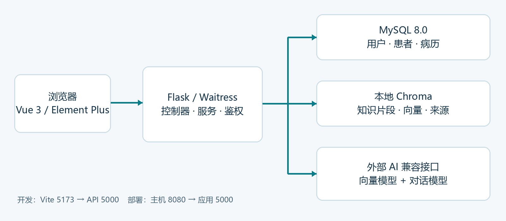
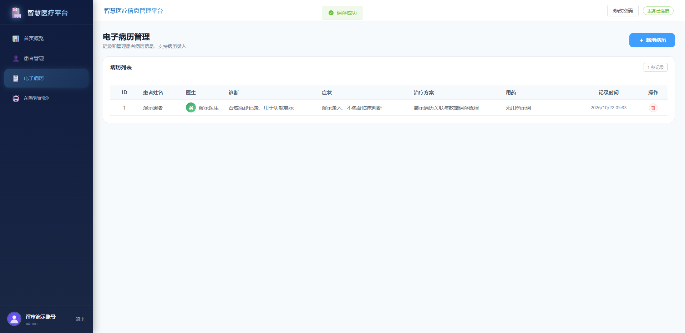

# 智慧医疗系统技术文档

文档版本：3.0 | 编制日期：2026-10-22 | 项目：RAG医疗系统

## 1 项目概述

本项目面向教学演示与毕业设计评审，将患者信息管理、电子病历管理和基于知识库的医疗知识问答整合为网页应用。系统让用户在统一界面完成档案登记、病历录入、资料导入和参考资料问答，减少在多个工具之间切换的操作。

项目采用 Vue 3、Flask、MySQL 与 Chroma，通过兼容接口连接向量模型和对话模型。RAG 的作用是向模型提供检索到的项目资料，回答时返回来源文件名，帮助使用者核对依据。

当前成果属于可运行的功能原型，没有临床有效性结论，不提供自主诊断、自动处方或治疗决策。界面中的“AI智能问诊”对应知识库辅助问答；它不读取患者或病历表生成个体诊断。

### 1.1 团队信息

| 成员 | 职责 |
| --- | --- |
| 高秋雨，项目负责人 | 需求分析、总体架构、后端核心模块、数据库设计、部署、版本管理、论文与核心技术文档，统筹进度 |
| 郝崇泽 | 前端页面、组件封装、页面样式、前后端接口联调 |
| 栾子璇 | 功能测试、Bug 记录与回归、用户手册辅助编写、素材整理 |

### 1.2 交付范围

交付代码仓库、环境模板、依赖清单、技术 PDF、普通话讲解的 1080p MP4、字幕与演示复现说明。GitHub 目标仓库为 gaoqiuyu9579/RAG-medical-system。公网在线演示经团队确认不纳入本次提交。

<!-- pagebreak -->

## 2 需求分析

核心使用者为演示管理员与知识资料使用者。管理员完成患者、病历和知识资料维护；使用者登录后基于资料提问。当前仅对用户列表实施管理员权限限制，没有细粒度病历访问授权。

### 2.1 功能需求及验收口径

| 编号 | 需求 | 当前验收口径 |
| --- | --- | --- |
| F01 | 身份认证 | 登录、JWT 校验、当前用户、修改密码，旧令牌失效 |
| F02 | 患者管理 | 列表、新增、删除；姓名必填，编号唯一，年龄 0 至 150 |
| F03 | 电子病历 | 选择有效患者后新增病历；列表与删除；保护关联患者 |
| F04 | 资料导入 | 粘贴文本或 TXT、MD、JSON、CSV、文本型 PDF |
| F05 | 智能问答 | 单轮问答，检索最多 3 个片段，返回回答与来源 |
| F06 | 统计与维护 | 首页真实统计、知识库状态、健康检查、备份与部署验证 |

### 2.2 非功能需求

可复现性：后端直接依赖指定版本，前端使用 package-lock.json 和 npm ci，提供 Docker 多阶段构建与 Compose 编排。可维护性：控制器、业务服务、模型、RAG 和工具分层，提供自动化回归及格式检查。

数据一致性：患者编号唯一、病历必须关联患者、有关联病历的患者不可直接删除。错误可定位性：接口返回统一结构和正确 HTTP 状态，外部服务错误不返回密钥或堆栈。

交互可用性：保存和问答阻止重复提交，删除需要确认，过期登录自动跳转；页面支持移动菜单与响应式弹窗。手机号等演示输入不被视为真实患者信息。

### 2.3 范围约束

未实现患者与病历编辑、分页、用户注册、长期会话历史、扫描件 OCR、知识库文件级权限与临床效果评价。本文将“已实现”和“规划中”分开陈述，避免将设计愿景作为验收成果。

<!-- pagebreak -->

## 3 系统架构设计

系统分为展示层、HTTP 接口层、业务服务层、数据访问层和 AI 知识服务。前端通过 Axios 访问同源 /api；开发环境由 Vite 将请求代理至后端。部署环境由 Waitress 同时提供构建后的前端静态资源和 API。

### 3.1 模块职责

| 模块 | 代码位置 | 主要职责 |
| --- | --- | --- |
| 应用工厂 | backend/app.py | 认证、错误处理、健康检查、静态资源 |
| 控制器 | backend/controller | 用户、患者、病历、知识库 HTTP 接口 |
| 业务服务 | backend/service | 输入处理、事务、关联检查、RAG 调用 |
| 数据模型 | backend/model | 用户、患者和病历 ORM 映射 |
| AI 服务 | backend/rag | 向量客户端、分块、检索和问答链 |
| 部署维护 | deploy | 初始化、启动、备份、密码维护、验证 |

### 3.2 部署拓扑

Docker 内部网络连接应用与 MySQL，主机默认只发布应用 8080 端口。MySQL、Chroma 与 JWT 签名密钥使用独立持久化卷。实际 AI 调用经过配置的外部服务地址，密钥由环境变量注入。

<!-- pagebreak -->

## 4 数据库与一致性设计

业务数据使用关系数据库，知识片段及向量使用 Chroma 集合。默认生产式演示部署使用 MySQL 8.0；自动化接口测试和独立录屏实例使用隔离 SQLite，不覆盖已有业务数据。

| 表 / 集合 | 关键字段 | 约束与用途 |
| --- | --- | --- |
| sys_user | id、username、password、role、status | 用户名唯一；密码哈希；状态控制登录 |
| patient | id、patient_no、name、age、medical_history | 编号唯一；年龄允许为空；关联病历的主体 |
| medical_record | id、patient_id、doctor_name、diagnosis、symptom、treatment、medicine | patient_id 必填；RESTRICT 外键；记录时间默认生成 |
| Chroma / langchain | 哈希 id、document、embedding、source | 内容去重；本地持久化；来源标记 |

患者与病历为一对多关系。新增病历先验证患者存在；删除患者前检查关联病历。MySQL 事务中的行锁协调新增与删除，数据库外键提供另一层保护。删除失败返回 409，事务异常回滚，避免后续请求持续处于失败事务中。

### 4.1 存量数据兼容

create_all 只创建缺失表，不等同于通用数据库迁移工具。项目启动检查为旧 MySQL 表补齐可应用的唯一约束与外键，使用命名锁协调。若发现重复编号或孤立病历，仅暂缓受影响的约束并记录警告，不自动改写或删除历史数据。

历史孤立病历在前端显示“待核对”，修复真实关联后，下次启动再添加外键。MySQL DDL 自动提交，正式处理历史数据前应先备份并验证恢复方法。该策略解决已有工程兼容问题，不代替完整迁移体系。

### 4.2 数据边界

用户列表不返回密码。问答链没有查询患者与病历表的代码。上传文本会发送至向量服务；用户问题及检索上下文会发送至对话服务。独立评审仅使用合成资料，不以“本地存储”为由声称所有数据都留在本机。

<!-- pagebreak -->

## 5 AI 技术方案与选型理由

本项目采用检索增强生成。业务知识可通过上传资料更新，无需为每次资料变化重新训练模型。与只把问题交给模型相比，系统先提供检索上下文，再要求回答给出可核对的资料来源；这有助于缩小回答依据范围，但不能保证消除幻觉。

| 组件 | 工程选型 | 选型理由与限制 |
| --- | --- | --- |
| 编排组件 | LangChain core、openai、text-splitters | 使用已集成的提示词、模型调用和分块接口，减少聚合依赖 |
| 向量模型 | text-embedding-v3 | 已有中文资料向量接口与项目存储可用；保持向量维度和集合兼容 |
| 对话模型 | deepseek-chat | 沿用工程中可验证的兼容接口配置，用于基于上下文生成回答 |
| 向量数据库 | Chroma 0.5.23 本地嵌入式 | 无需另建向量服务，支持持久化，兼容既有集合 |

以上是工程选型理由。本次没有构建标准问答数据集进行跨模型准确率、价格或延迟比较，因此不宣称选型具有行业最高质量或最低成本。模型名称是本工程实际配置的标识，不表示服务商当前最新版本；接入地址、模型权限与价格应以服务商官方说明及实际账号为准。

### 5.1 集成方式

向量客户端使用 OpenAIEmbeddings，通过 DASHSCOPE_API_KEY 与 DASHSCOPE_BASE_URL 连接兼容接口；设置 tiktoken_enabled=False 和 check_embedding_ctx_length=False，按现有服务输入约定传入分块文本。

对话客户端使用 ChatOpenAI，通过 DEEPSEEK_API_KEY 与 DEEPSEEK_BASE_URL 连接兼容接口，temperature=0.3。两种客户端独立配置，均设置 45 秒请求超时与最多 1 次重试。不存在本地模型训练或微调步骤。

参考官方接口文档：[DeepSeek 接口说明](https://api-docs.deepseek.com/)、[阿里云向量接口说明](https://www.alibabacloud.com/help/en/model-studio/embedding)。

<!-- pagebreak -->

## 6 AI 集成流程与回答约束

### 6.1 资料导入

客户端上传文件或粘贴文本 → 后端提取并校验 → 递归分块 → 计算 SHA256 标识 → 检查已有片段 → 对全部新增片段完成向量化 → 一次写入 Chroma。文件路径只保留安全文件名作为来源，不在接口中持久化用户上传的任意路径。

文本分块参数为 chunk_size=500、chunk_overlap=50，单位是字符而非 token。片段内容作为哈希输入，同一文本片段可去重；当前去重不做语义近似判重，也不保存同一片段全部重复文件的来源关系。

输入仅支持 UTF-8 或 UTF-8 BOM；PDF 需有可提取的文本层。请求大小上限为 16 MB，提取文本上限 20 万字符，PDF 上限 200 页。扫描件不会自动 OCR，资料过长时需拆分后上传。

### 6.2 检索问答

问题校验 → 问题向量化 → 在集合中检索最多 3 个片段 → 拼接参考上下文 → 系统提示词与用户问题调用模型 → 返回 answer 和去重后的 sources。空知识库直接返回明确提示，不调用外部模型。

系统提示要求仅依据参考资料回答、不执行资料中的指令、资料不足时说明情况、不编造医学事实，并声明回答不能代替医生诊断。参考文本放在 context 标签内，与系统指令分离；这是降低提示注入风险的措施，不是经过系统性对抗测试的保证。

### 6.3 来源与能力边界

返回的是参与检索的来源文件名，不是对答案逐句验证后的引文，也没有 PDF 页码或证据句高亮。目前没有相关性阈值、重排序或混合检索，因此非空库仍可能检索到弱相关文本。回答约束依赖模型遵循提示，仍需要人工核对。

录屏使用 docs/demo_knowledge.md 中的合成窗口资料，实际请求外部向量和对话服务。问题包含窗口开放时间、登记材料，以及资料未提供的药物剂量；具体调用结果保存在演示证据 JSON 中。

<!-- pagebreak -->

## 7 AI 优化策略与评估方法

| 策略 | 实现参数 / 方法 | 作用与实际限制 |
| --- | --- | --- |
| 分块重叠 | 500 字符，重叠 50 | 降低边界断句；不是依据评测得出的最优参数 |
| 检索数量控制 | Top-3，少于 3 时取实际数量 | 限制上下文长度；可能漏掉跨文档信息 |
| 内容去重 | SHA256 内容标识 | 降低重复导入；不能识别语义相似改写 |
| 写入顺序 | 先完成新增向量化，再 collection.add | 避免外部向量请求中途失败造成半份资料；不保证任何底层故障都原子回滚 |
| 批量向量请求 | 每批 10 条 | 控制单批规模；大文件会经历多批调用 |
| 服务边界 | 45 秒超时，最多 1 次重试 | 单次外部请求有等待边界；整次上传可能超过 45 秒 |
| 本地持久化 | PersistentClient，关闭匿名遥测 | 重启后保留知识库，减少重复构建 |
| 空库短路 | 检索前检查集合 | 无资料时不请求对话模型 |

### 7.1 已完成的验证

本地向量回归验证实际 Chroma 写入、重复文本不新增、旧集合可读和检索后来源返回。模型替身用于检查上下文传递和响应契约，不用于证明医学质量。真实联调另验证向量维度、合成资料编号问答与来源一致性。

### 7.2 后续质量评价

计划建立经过专业人员审核、带来源与参考答案的中文资料问答集，评估 Recall@k、来源覆盖率、答案忠实性、资料不足时的正确拒答率，以及延迟和 token 消耗。然后比较分块参数、Top-k、重排序和混合检索。在该评测完成前，不提供编造的准确率、召回率或性能提升百分比。

<!-- pagebreak -->

## 8 核心功能实现

### 8.1 账号与认证

密码采用 Werkzeug scrypt 哈希，旧明文值仅在成功登录时迁移。JWT 使用 HS256，包含必须字段和密码版本，默认有效期 12 小时。请求同时检查账号状态；修改密码后，密码版本变化会使旧令牌失效。

SECRET_KEY 未配置或为旧占位值时，生成随机密钥并写入 instance/jwt.secret。Docker 持久化该目录，以免正常重启造成签名密钥变化。用户列表仅管理员可访问；患者和病历目前没有按医生或机构进一步隔离权限。

### 8.2 患者与病历

患者新增支持自动编号、可空年龄与编号冲突检测；病历新增校验关联患者，并保存医生、诊断、症状、方案和用药字段。删除流程包含前端确认与后端关联保护。异常后主动回滚事务，保证数据库连接可继续处理请求。

### 8.3 首页与移动体验

首页统计直接来源于数据库和知识库状态。“今日就诊”表示当日新增病历数量，不表示已完成的真实诊疗人次。前端支持菜单收起、中文组件提示、响应式弹窗、会话损坏恢复和 401 自动返回登录。

<!-- pagebreak -->

## 9 接口设计与错误处理

接口统一返回 code、msg、data；成功时 code=200，失败同时使用相应 HTTP 状态码。除登录和健康检查外，业务 API 要求 Authorization: Bearer 登录凭证。未找到的 API 返回 JSON 404，不回落为前端首页。

| 方法 | 路径 | 关键行为 |
| --- | --- | --- |
| GET | /api/health | 执行数据库 SELECT 1 |
| POST | /api/user/login | 用户登录 |
| GET | /api/user/me、/api/user/stats | 当前用户、首页统计 |
| POST | /api/user/password | 修改密码，旧凭证失效 |
| GET | /api/user/list | 管理员用户列表 |
| GET / POST | /api/patient/list、/api/patient/add | 查询、新增患者 |
| DELETE | /api/patient/delete/{id} | 拒绝删除关联病历的患者 |
| GET / POST | /api/medical/list、/api/medical/add | 查询、新增病历 |
| DELETE | /api/medical/delete/{id} | 删除病历 |
| GET | /api/rag/status | 知识片段数量与状态 |
| POST | /api/rag/upload、/api/rag/upload-file | 文本或文件导入 |
| POST | /api/rag/chat | 返回 answer、sources |

输入不合法、未登录、权限不足、缺失资源、关联冲突、请求过大分别映射至 400、401、403、404、409、413。外部 AI 服务异常映射为 503，并提供认证失败、请求受限或超时等简明信息。

接口响应设置 Cache-Control: no-store，响应设置 X-Content-Type-Options: nosniff。CORS 默认仅允许本机前端开发来源；Docker 同源访问不需要额外跨域配置。服务器日志不直接记录服务密钥，上游异常不向浏览器回传堆栈。

<!-- pagebreak -->

## 10 测试验证与证据

测试日期：2026-10-22。具体执行结果及失败修复说明以 docs/验收测试报告.md 为准。测试数据与实际业务数据隔离，不向现有患者库插入演示记录。

| 验证层次 | 方法 | 主要覆盖 |
| --- | --- | --- |
| 后端回归 | unittest，独立 SQLite | 鉴权、密码迁移、输入边界、关联保护、异常恢复、上传限制 |
| 向量回归 | 实际隔离 Chroma + 可控模型 | 持久化、去重、检索上下文、来源、向量失败处理 |
| MySQL 专项 | 随机命名测试库 | 历史重复编号、孤立病历、约束补齐与兼容启动 |
| 前端单元 | Node.js test | 会话缺失、损坏、过期、退出等 6 个场景 |
| 浏览器回归 | Playwright / Edge | 8 个场景分别在桌面和移动视口执行，共 16 项 |
| 真实 AI 联调 | 合成资料，真实客户端 | 向量服务、对话服务、回答编号和来源 |
| 部署检查 | 正在运行的 Docker 服务 | 静态资源、SPA 路由、健康检查、已认证只读接口 |

### 10.1 本次发现及修复

移动端登录失效测试的辅助函数曾在页面跳转时读取已销毁的执行环境，改为可重试的 Locator 断言。真实 RAG 联调曾在 Windows 清理 Chroma 临时文件时触发占用错误，改为子进程执行联调、退出释放句柄后由父进程清理。两项修改属于验证脚本修复，不将首次失败隐去。

### 10.2 验证边界

本次验证不等于真实医生质量评价、互联网渗透测试、生产压测、长期稳定性观测或真实手机网络验证。构建存在公共组件包体积提示；Chroma 旧版本存在历史安全公告，不能声称依赖零风险。项目未启用 Chroma HTTP 多租户服务或远程模型执行，升级仍需验证旧向量数据兼容。

<!-- pagebreak -->

## 11 环境配置、部署与维护

推荐使用 Docker Desktop 的 Linux 容器模式。初次复制 .env.example 为 .env，填写两类 AI 密钥及需要自定义的数据库、账号参数；运行 docker compose up -d --build --wait --wait-timeout 240，然后访问 http://localhost:8080。

### 11.1 环境变量

| 配置组 | 变量 | 说明 |
| --- | --- | --- |
| 本机数据库 | MYSQL_HOST、MYSQL_PORT、MYSQL_USER、MYSQL_PASSWORD、MYSQL_DATABASE | 默认本机 MySQL 连接；密码支持特殊字符 |
| AI 对话 | DEEPSEEK_API_KEY、DEEPSEEK_BASE_URL | 密钥与兼容接口地址 |
| AI 向量 | DASHSCOPE_API_KEY、DASHSCOPE_BASE_URL | 密钥与兼容接口地址 |
| 认证与跨域 | SECRET_KEY、SECRET_KEY_FILE、CORS_ORIGINS、FLASK_DEBUG | 随机密钥可持久化；默认关闭 debug |
| 本机初始化 | BOOTSTRAP_ADMIN_USERNAME、BOOTSTRAP_ADMIN_PASSWORD | 仅创建不存在的管理员 |
| Docker 配置 | DOCKER_HTTP_PORT、DOCKER_ADMIN_USERNAME、DOCKER_ADMIN_PASSWORD | 网页端口与首次管理员 |
| Docker 数据库 | DOCKER_MYSQL_ROOT_PASSWORD、DOCKER_MYSQL_USER、DOCKER_MYSQL_PASSWORD、DOCKER_MYSQL_DATABASE | 容器数据库初始化；已有卷不会自动改密码 |

### 11.2 本机开发

准备 Python 3.11、Node.js 22、MySQL 8.0。安装 requirements-docker.txt，按 README 初始化缺失管理员后执行 python -m deploy.start；前端目录执行 npm ci 和 npm run dev，访问 5173 端口。单独由后端提供页面时先 npm run build。

开发依赖位于 requirements-dev.txt，文档和视频重建依赖位于 requirements-artifacts.txt。环境变量优先于 .env，真实配置和业务数据不提交 Git。Docker 中的数据库主机固定为 mysql，不使用本机 MYSQL_HOST。

### 11.3 备份与故障恢复

deploy/backup.py 导出业务 SQL、知识库及可用时的签名密钥，暂时暂停写入后恢复服务。备份保存在本机 backups，不上传公开仓库。恢复应先停应用并在隔离环境验证，再导入 SQL 和持久化目录。docker compose down 保留卷；加 -v 会删除数据。

<!-- pagebreak -->

## 12 创新点说明

本项目的创新定位为教学项目中的技术整合与应用流程改进，不宣称发明 RAG 算法、向量模型或通用医疗诊断方法。

### 12.1 技术创新与工程改进

| 创新 / 改进点 | 具体实现 | 可核对证据 |
| --- | --- | --- |
| 可追溯资料问答 | 检索片段携带 source，响应返回去重后的文件名 | qa_chain.py、浏览器来源展示 |
| 重复上传控制 | SHA256 片段 id，先检查已有标识再向量化 | vector_store.py、重复上传 added=0 |
| 外部调用失败保护 | 新增片段全部向量化后再写入，超时与有限重试 | 向量失败回归、客户端参数 |
| 存量约束兼容 | 有冲突时仅暂缓受影响约束，不改写旧数据 | schema.py、4 项 MySQL 专项测试 |
| 可复现实验隔离 | 回归、真实 AI 联调和录屏数据相互隔离 | tests、check_rag_live、demo_server |

### 12.2 应用创新

统一操作入口：患者登记、病历关联和知识问答在同一网页提供，减少教学演示中的工具切换。来源可见：回答同时呈现来源文件名，使用者能回到导入资料核对。资料不足提醒：以参考上下文约束回答，提醒使用者人工核对，不把生成结果自动转成处方。

上述创新适用于本项目的组合方案，当前尚未通过与外部产品的系统比较证明唯一性或领先性。创新效果以功能可操作、约束可验证和交付可复现为依据，不编造量化收益。

<!-- pagebreak -->

## 13 总结与展望

项目已形成从登录、患者登记、病历关联到资料导入和 RAG 问答的完整原型流程。工程交付强调来源核对、数据一致性、运行配置和自动化验证，方便评审按代码、文档和实际画面对照检查。

### 13.1 当前限制

业务层尚缺编辑、分页、注册、细粒度病历权限和操作审计；知识层没有 OCR、重排序、混合检索、来源页码或质量评测集；对话为单轮，不保存历史。公网 HTTPS、登录限流及长期服务值守未作为本次交付内容。

### 13.2 后续路线

第一阶段完善细粒度授权、日志审计、登录限流和脱敏策略；第二阶段建立专业审核的问答评测集，比较检索配置并补充证据引用；第三阶段再评估 OCR、混合检索、重排序和受控会话历史。模型与 Chroma 升级应包含旧资料迁移和回归验证。

### 13.3 版本与历史真实性

本次检查时本地没有 Git 提交。首个提交保留已有工程，后续记录对应本次真实的规范整理、脚本修复和交付制作；它们不能补证此前完整开发历史。若有其他设备或原仓库的早期记录，应另行完整迁入并保留。当前未倒填日期或伪造成员提交。

### 13.4 评审复现

阅读 README，复制环境模板、配置 AI 服务并启动 Docker；先完成患者及病历流程，再导入合成演示资料并提问。无需配置公网服务。隔离录屏实例可通过 python scripts/demo_server.py 启动，账号 reviewer、密码 ReviewDemo2026!，仅监听 127.0.0.1:5502。

<!-- pagebreak -->

## 14 参考资料与交付索引

资料核对日期：2026-10-22。外部文档用于说明协议或产品能力，实际项目参数以仓库代码和本次运行证据为准。服务商文档与模型名称可能更新，部署前需结合账号可用性验证。

| 资料 | 地址 / 本地位置 |
| --- | --- |
| DeepSeek 官方接口 | https://api-docs.deepseek.com/ |
| 阿里云向量接口 | https://www.alibabacloud.com/help/en/model-studio/embedding |
| GitHub 建仓说明 | https://docs.github.com/en/repositories/creating-and-managing-repositories/creating-a-new-repository |
| 工程入口与团队 | README.md |
| 完整部署操作 | docs/部署与启动.md |
| 测试及当前证据 | docs/验收测试报告.md |
| 交付逐项检查 | docs/交付检查清单.md |
| 演示视频与重建 | docs/演示视频与复现.md、docs/video_storyboard.json |
| 录屏真实调用结果 | output/video/demo-evidence.json |
| Git 历史说明 | docs/GitHub提交说明.md |

文档由 Markdown 源文件与脚本生成，包含项目概述、需求分析、架构、AI 选型与集成、优化策略、核心实现、测试部署、技术与应用创新、总结展望。生成脚本会验证总页数不超过 30 页，最终交付以生成后的 PDF 为准。
